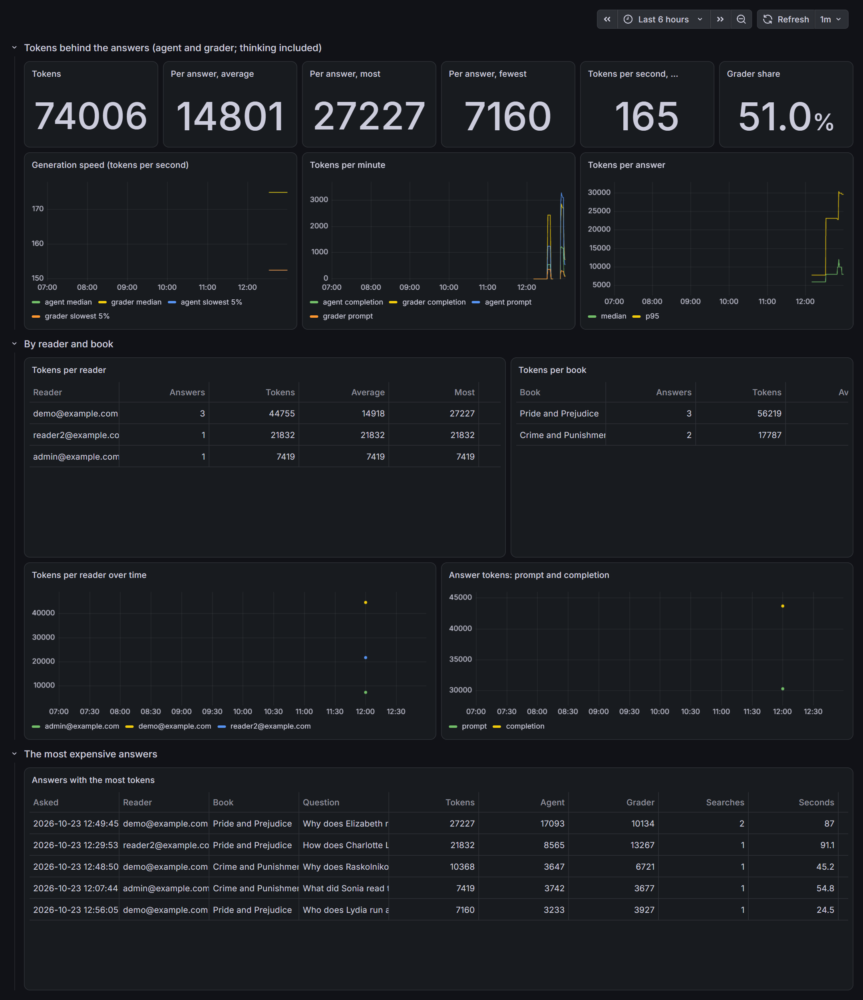
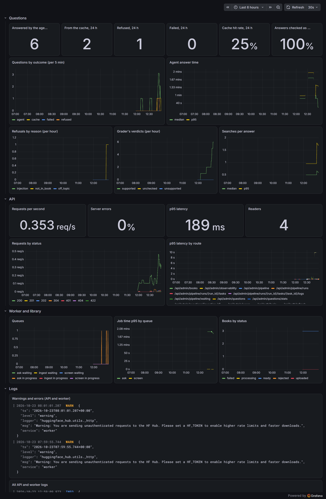
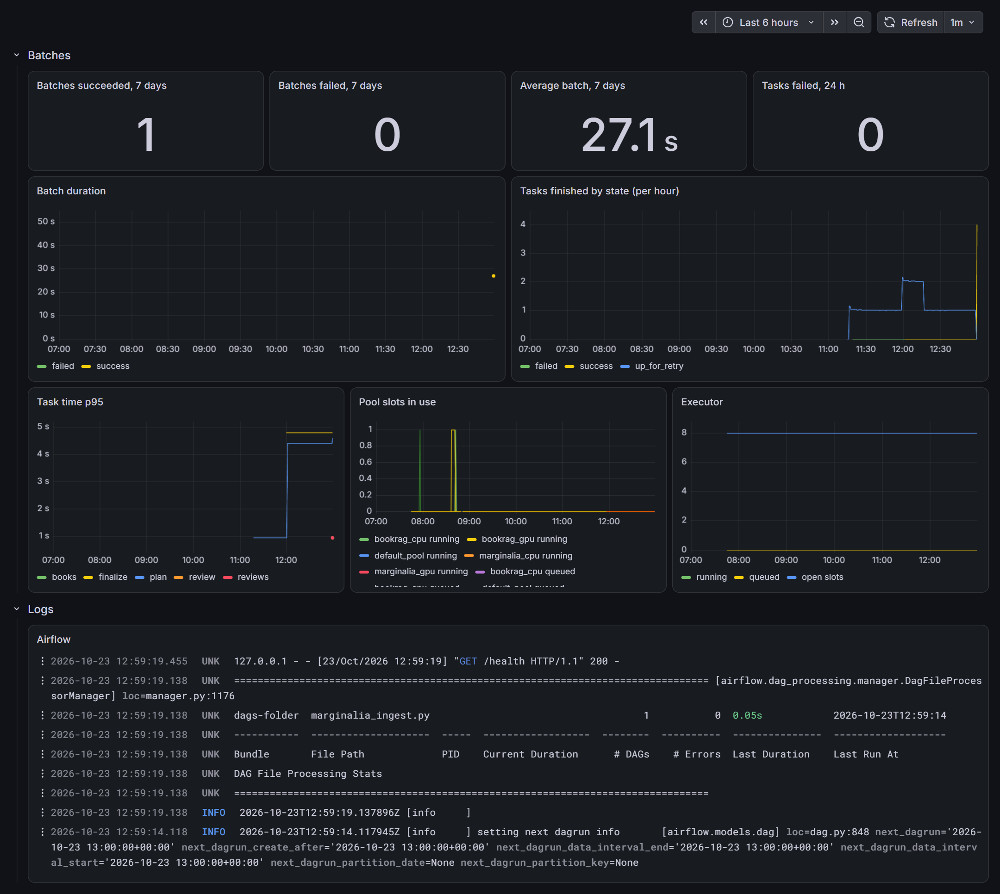

# 14 · Observability: logs, metrics, dashboards and tokens

Notebook: [14-observability.ipynb](14-observability.ipynb) · Code: `src/marginalia/logs.py`, `src/marginalia/metrics.py`,
`docker/observability/`

## What it does

Lets you see what the running system is doing:

- **Metrics:** every process exports numbers (requests, latency, questions by outcome, refusals,
  tokens, queue lengths). Prometheus collects them.
- **Logs:** every container's logs, structured as JSON lines, go to Loki.
- **Dashboards:** Grafana shows three, one each for readers and questions, batches, and tokens, with
  the logs next to the charts.
- **Alerts:** a few rules flag a service down, failing questions, slow answers and failed batches.

## Why?

A RAG system fails quietly. Answers get slower when the GPU is shared, the cache stops hitting after
a change, a batch fails at 3 a.m., one reader's questions cost ten times the tokens. Without numbers
over time you notice only when someone complains. Tokens are the cost of every answer: you want to
see them per answer, per reader and per book, and how fast the model generates them.

## For what

- Checking health at a glance, and finding a slow or failing piece.
- Tracking LLM cost: tokens per answer, per reader, per book, and generation speed.
- Investigating one request across services: its `request_id` is in every log line, so Loki finds
  them all.

## Simple explanation

Gauges and a logbook. Each part of the machine has gauges (how many, how fast, how long) that
Prometheus reads every 15 seconds and remembers. Each part also writes a logbook, and Loki keeps them
all in one place. Grafana is the control room wall with the gauges' history and the logbook side by
side.

## Examples

| Dashboard | Shows |
|---|---|
| MarginaliaRAG: readers and questions | answered, cached, refused, failed; answer time; refusals by reason; the grader's verdicts; API traffic and latency by route; queues; books; logs |
| MarginaliaRAG: batches (Airflow) | batches succeeded and failed, durations, tasks by state, task time, pools, Airflow logs |
| MarginaliaRAG: tokens | tokens in total and per answer (average, most, fewest), tokens per second, grader share; tokens per reader and per book; the most expensive answers |


*MarginaliaRAG: tokens.*


*MarginaliaRAG: readers and questions.*


*MarginaliaRAG: batches (Airflow).*

## Technical

- **Logs:** `logs.setup(service)` sends JSON lines (`CP_LOG_FORMAT=json`, the default in Docker) or text
  to stderr. Each line carries `ts`, `level`, `logger`, `msg`, the service, the request id (a context
  variable set by the API's middleware) and any `extra=` fields such as `question_id` or `tokens`.
- **Metrics:** `marginalia.metrics` exports them with `prometheus_client`, on port 9100 inside the
  network only.

  | Metric | What it counts |
  |---|---|
  | `marginalia_http_requests_total{method,route,status}`, `marginalia_http_request_duration_seconds` | API traffic, by route *template* |
  | `marginalia_questions_total{outcome}`, `marginalia_questions_refused_total{reason}` | questions by outcome; refusals |
  | `marginalia_answer_seconds`, `marginalia_agent_tool_calls`, `marginalia_answers_checked_total{verdict}` | agent time, searches, grader verdicts |
  | `marginalia_llm_tokens_total{role,kind,model}`, `marginalia_llm_calls_total` | tokens and calls by role |
  | `marginalia_llm_tokens_per_answer`, `marginalia_llm_tokens_per_second{role}` | tokens per answer, speed |
  | `marginalia_jobs_total`, `marginalia_job_seconds`, `marginalia_screen_seconds` | the worker |
  | `marginalia_queue_length{queue,state}`, `marginalia_books{status}`, `marginalia_users{state}` | refreshed by the API every 30 s |

  Known label combinations start at 0, so series exist after a restart.
- **Airflow:** its StatsD metrics go to `statsd-exporter`, which maps them to labelled
  `airflow_dagrun_duration_seconds` and `airflow_task_finished_total{task_id,state}`.
- **Loki and Alloy:** Alloy reads this compose project's container logs through the Docker socket.
  It parses JSON into a `level` label and `logger`, `request_id` and `question_id` metadata. Loki keeps
  7 days.
- **Grafana:** data sources for Prometheus, Loki and **Postgres** (the read-only `marginalia_reporting`
  login, which can read only `reporting.questions`). The per-reader token figures come from that
  view. The dashboards are generated by `docker/observability/build_dashboards.py`.
- **Alerts:** `alerts.yml` defines `MarginaliaRAGDown`, `ApiErrors`, `QuestionsFailing`, `SlowAnswers`,
  `QuestionBacklog` and `BatchFailed`. They fire in Prometheus and Grafana; add Alertmanager or contact
  points to get notified.

## Tech examples

```bash
docker compose --profile observability up -d
open http://127.0.0.1:3030          # Grafana (CP_GRAFANA_USER / CP_GRAFANA_PASSWORD)
python docker/observability/build_dashboards.py
```

```promql
histogram_quantile(0.5, sum by (le, role) (rate(marginalia_llm_tokens_per_second_bucket[30m])))
sum by (role, kind) (rate(marginalia_llm_tokens_total[5m])) * 60
```

```sql
SELECT reader, count(*), sum(total_tokens), max(total_tokens), min(total_tokens)
FROM reporting.questions WHERE total_tokens IS NOT NULL GROUP BY reader;
```

## How it is connected to other steps

- **Logs and metrics:** come from the API and worker (step 12), the agent's token counts (step 09), the
  guard and cache (step 10) and Airflow (step 13).
- **The token and question panels:** read the same reporting view as Evidently (step 15).
- **The admin page:** links to Grafana (**Dashboards**).
